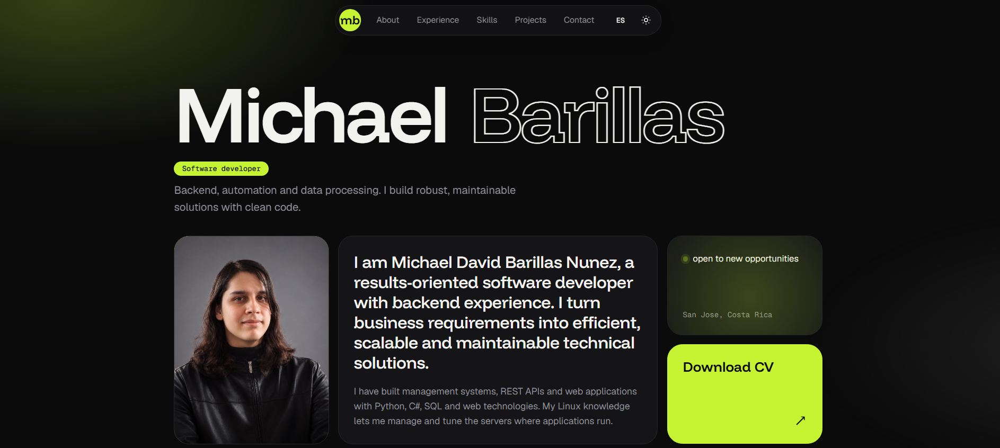

# Portafolio / Portfolio

[Español](#español) | [English](#english)

Demo: https://portafoliomichaelbarillas.netlify.app/

<p align="center">
  
</p>

---

## Español

Portafolio personal de **Michael Barillas**, desarrollador de software enfocado en backend y automatización. Es un sitio estático hecho con HTML, CSS y JavaScript puro: no necesita compilación ni dependencias.

### Características

- Español e inglés, con selector de idioma y detección automática según el navegador.
- Modo claro y oscuro, con la preferencia guardada en el navegador.
- Animación de entrada y animaciones al hacer scroll, con soporte para quienes reducen el movimiento en su sistema.
- Botón de descarga de CV que entrega el archivo en español o en inglés según el idioma activo.
- Proyectos con filtros por categoría, generados automáticamente.
- Formulario de contacto funcional mediante Formspree.
- Diseño adaptable a móvil, tableta y escritorio.
- Contenido separado del código: todo se edita en un solo archivo.

### Estructura

```
.
├── index.html          Contenedores de las secciones
├── css/
│   └── styles.css      Estilos, colores y tipografías
├── js/
│   ├── data.js         Todo el contenido (perfil, habilidades, experiencia, proyectos, textos ES/EN)
│   └── main.js         Renderizado, idioma, tema, filtros y formulario
├── assets/
│   ├── img/
│   │   ├── profile.jpg
│   │   └── projects/   Imágenes de los proyectos
│   └── cv/             CV en español e inglés
├── LICENSE
└── README.md
```

### Uso local

No hace falta instalar nada. Abre `index.html` en el navegador, o levanta un servidor local (recomendado para probar el formulario):

```bash
python -m http.server 8000
```

Luego visita `http://localhost:8000`.

### Personalización

Todo el contenido está en `js/data.js`. Los campos con la forma `{ es: '...', en: '...' }` son bilingües.

**Datos personales y CV**

```js
profile: {
  name: 'Tu Nombre',
  email: 'tu-correo@ejemplo.com',
  photo: 'assets/img/profile.jpg',
  cv: {
    es: 'assets/cv/CV-ES.pdf',
    en: 'assets/cv/CV-EN.pdf'
  },
  formspree: 'https://formspree.io/f/TU_ID'
}
```

**Agregar un proyecto**

1. Guarda la imagen en `assets/img/projects/`.
2. Copia un objeto del arreglo `projects` y modifica sus datos:

```js
{
  title: { es: 'Mi proyecto', en: 'My project' },
  type: 'personal',
  categories: ['web'],
  image: 'assets/img/projects/mi-proyecto.png',
  description: { es: 'Descripción breve.', en: 'Short description.' },
  stack: ['JavaScript', 'CSS'],
  links: [{ type: 'code', url: 'https://github.com/usuario/repo' }]
}
```

La tarjeta y su filtro aparecen automáticamente. Valores disponibles:

- `type`: `client`, `internship`, `academic`, `api`, `automation`, `personal`.
- `categories`: `professional`, `backend`, `web`, `desktop`.
- `links[].type`: `code` o `demo`.
- `confidential: true` muestra la etiqueta de código confidencial en lugar de enlaces.

Para usar un `type` o una categoría nuevos, agrega también su etiqueta (`type_nombre` o `cat_nombre`) en la sección `ui` de ambos idiomas.

**Experiencia y habilidades**

Agrega objetos a los arreglos `experience` y `skills`. Una habilidad con `level` se muestra como barra y sin `level`, como etiqueta.

**Colores y tipografías**

Los colores de ambos temas están al inicio de `css/styles.css`, como variables CSS.

### Formulario de contacto

El formulario envía los datos a [Formspree](https://formspree.io). Crea un formulario allí, copia su dirección (`https://formspree.io/f/...`) y colócala en `formspree` dentro de `data.js`. En el primer envío, Formspree pide confirmar tu correo.

### Despliegue

Al ser un sitio estático, se publica sin configuración adicional en Netlify, GitHub Pages, Vercel o cualquier hosting estático. Las rutas de archivos distinguen mayúsculas y minúsculas, así que `Profile.jpg` y `profile.jpg` no son lo mismo.

### Licencia y contenido

El código se distribuye bajo la licencia [MIT](LICENSE). La foto, los CV, los textos personales y las imágenes de los proyectos son contenido personal del autor y no están incluidos en esa licencia. Las tipografías provienen de Google Fonts y se rigen por sus propias licencias abiertas.

### Autor

Michael David Barillas Núñez, [GitHub](https://github.com/Mike-rako).

---

## English

Personal portfolio of **Michael Barillas**, a software developer focused on backend and automation. It is a static site built with plain HTML, CSS and JavaScript: no build step and no dependencies.

### Features

- Spanish and English with a language switch and automatic detection from the browser.
- Light and dark mode, with the preference saved in the browser.
- Entrance animation and scroll animations, with support for users who reduce motion in their system.
- CV download button that serves the Spanish or English file depending on the active language.
- Projects with category filters generated automatically.
- Working contact form through Formspree.
- Responsive design for mobile, tablet and desktop.
- Content separated from code: everything is edited in a single file.

### Structure

```
.
├── index.html          Section containers
├── css/
│   └── styles.css      Styles, colors and typography
├── js/
│   ├── data.js         All content (profile, skills, experience, projects, ES/EN text)
│   └── main.js         Rendering, language, theme, filters and form
├── assets/
│   ├── img/
│   │   ├── profile.jpg
│   │   └── projects/   Project images
│   └── cv/             Spanish and English CVs
├── LICENSE
└── README.md
```

### Running locally

Nothing needs to be installed. Open `index.html` in your browser, or start a local server (recommended to test the form):

```bash
python -m http.server 8000
```

Then visit `http://localhost:8000`.

### Customization

All content lives in `js/data.js`. Fields shaped like `{ es: '...', en: '...' }` are bilingual.

**Personal data and CV**

```js
profile: {
  name: 'Your Name',
  email: 'your-email@example.com',
  photo: 'assets/img/profile.jpg',
  cv: {
    es: 'assets/cv/CV-ES.pdf',
    en: 'assets/cv/CV-EN.pdf'
  },
  formspree: 'https://formspree.io/f/YOUR_ID'
}
```

**Adding a project**

1. Save the image in `assets/img/projects/`.
2. Copy an object from the `projects` array and edit its data:

```js
{
  title: { es: 'Mi proyecto', en: 'My project' },
  type: 'personal',
  categories: ['web'],
  image: 'assets/img/projects/my-project.png',
  description: { es: 'Descripción breve.', en: 'Short description.' },
  stack: ['JavaScript', 'CSS'],
  links: [{ type: 'code', url: 'https://github.com/user/repo' }]
}
```

The card and its filter appear automatically. Available values:

- `type`: `client`, `internship`, `academic`, `api`, `automation`, `personal`.
- `categories`: `professional`, `backend`, `web`, `desktop`.
- `links[].type`: `code` or `demo`.
- `confidential: true` shows the confidential code label instead of links.

To use a new `type` or category, also add its label (`type_name` or `cat_name`) in the `ui` section for both languages.

**Experience and skills**

Add objects to the `experience` and `skills` arrays. A skill with `level` is shown as a bar, and without `level` as a tag.

**Colors and typography**

The colors for both themes are at the top of `css/styles.css`, as CSS variables.

### Contact form

The form sends its data to [Formspree](https://formspree.io). Create a form there, copy its address (`https://formspree.io/f/...`) and place it in `formspree` inside `data.js`. On the first submission, Formspree asks you to confirm your email.

### Deployment

As a static site, it can be published with no extra configuration on Netlify, GitHub Pages, Vercel or any static hosting. File paths are case-sensitive, so `Profile.jpg` and `profile.jpg` are different files.

### License and content

The code is released under the [MIT](LICENSE) license. The photo, CVs, personal texts and project images are the author's personal content and are not covered by that license. Fonts come from Google Fonts and follow their own open licenses.

### Author

Michael David Barillas Núñez, [GitHub](https://github.com/Mike-rako).